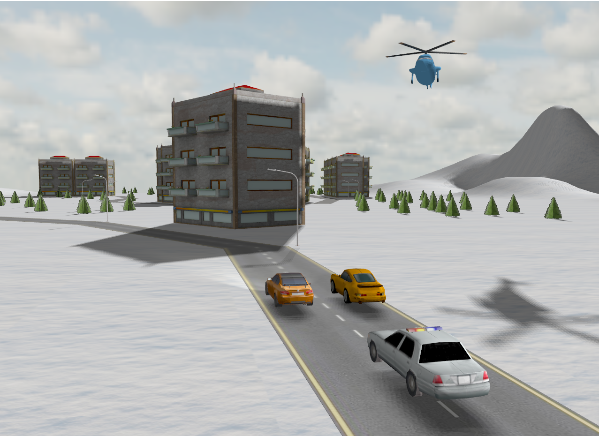

# 🏙️ Interactive 3D Urban Scene with Dynamic Lighting & Photorealistic Rendering




A real-time 3D interactive urban environment simulation built with C++ and OpenGL 3.3 (Programmable Pipeline). The project integrates multi-source Blinn-Phong shading, high-resolution shadow mapping with 5x5 Percentage Closer Filtering (PCF) soft shadows, dynamic fog, rigid body collision handling, spatial 3D audio, and interactive camera tracking.

---

## 🌟 Technical Highlights

* **Multi-Source Shading Engine:** Global directional sunlight coupled with 4 dynamic spotlight sources (vehicle headlights and alternating police strobe lights).
* **Shadow Mapping & 5x5 PCF:** Two-pass depth buffer rendering using an orthogonal light-space projection matrix combined with a 25-sample Percentage Closer Filtering kernel for anti-aliased soft shadow boundaries.
* **Oriented Bounding Box (OBB) Collisions:** Precise 3D vehicle-to-building collision detection algorithm transforming world-space vehicle coordinates into building local space.
* **NFS-Style Smooth Third-Person Camera:** Dynamically interpolated camera movement (`glm::mix`) following the vehicle's forward orientation vector for fluid driving gameplay.
* **Hierarchical Model Decomposition:** Vehicle models are split into chassis and 4 individual wheel sub-mesh components to allow realistic rotational velocity physics tied to vehicle displacement.
* **Distance-Based Fog:** Real-time atmospheric fog computed in the fragment shader using exponential decay calculations based on fragment-to-camera distance.
* **3D Spatial Audio:** Integrated audio pipeline using irrKlang for dynamic engine sounds and siren audio effects based on listener proximity.

---

## 🏗️ Architecture & Class Hierarchy

```text
├── Camera         - View matrix management, Euler angle calculation, smooth interpolation
├── Shader         - Compiles, links, and manages GLSL vertex and fragment shader programs
├── Model3D        - Uses tiny_obj_loader for parsing .obj meshes and generating VAO/VBO/EBO buffers
├── Mesh           - Manages individual geometry sub-meshes, texture maps, and draw calls
└── SkyBox         - Cubemap texture rendering with gl_clamp edge fitting
```

---

## 🎮 Controls & Interaction

| Input | Action | Description |
| :--- | :--- | :--- |
| **`W` `A` `S` `D`** | Vehicle / Camera Drive | Accelerate, steer, reverse, or move free camera |
| **`Mouse`** | Camera Look | Look around in Free Camera mode |
| **`1`** | Toggle Camera Mode | Switch between Free Camera and NFS-Style Third-Person Tracking |
| **`2` `3` `4`** | Vehicle Selection | **2:** BMW M3 \| **3:** Porsche 911 \| **4:** Police Cruiser |
| **`5` `6` `7`** | Render Polygon Mode | **5:** Solid Shading \| **6:** Wireframe \| **7:** Point Cloud |
| **`8` `9`** | Fog Density | **8:** Decrease Fog \| **9:** Increase Fog |
| **`Arrow Keys`** | Sun Vector Control | Real-time adjustment of directional light and shadow angles |
| **`M` / `N`** | Mouse Cursor | **M:** Release cursor \| **N:** Lock cursor |

---

## 🚀 Building & Execution

1. Clone the repository:
   ```bash
   git clone [https://github.com/mihai-cezarr/3d-urban-scene-opengl.git](https://github.com/mihai-cezarr/3d-urban-scene-opengl.git)
   ```
2. Open `ProiectPG.sln` in **Visual Studio 2022**.
3. Select **Release / x64** build configuration.
4. Press `F5` to build and launch the application.

> ℹ️ **Note:** The dynamic libraries `irrKlang.dll` and `ikpMP3.dll` are included in the project directory and must remain alongside the compiled executable.

---
*Developed by **Mihai-Cezar Turceniuc** (Computer Science, Technical University of Cluj-Napoca).*